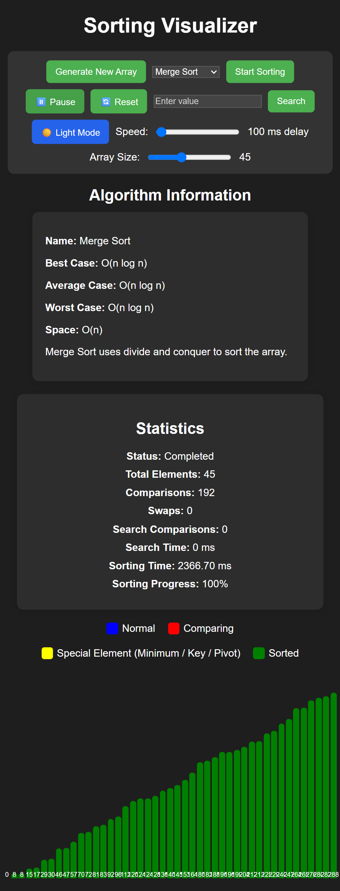
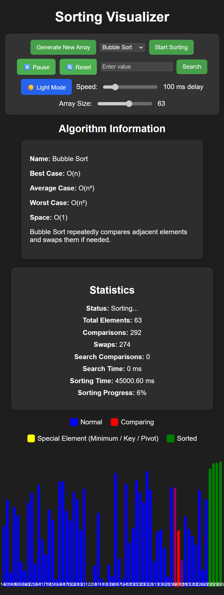
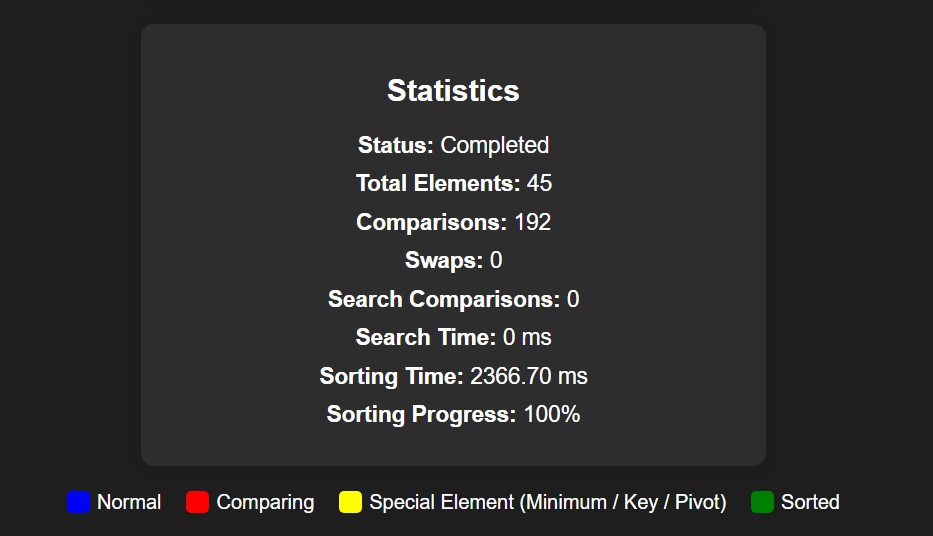

# DSA Visualizer – Sorting & Searching Algorithms

An interactive, browser-based DSA Visualizer built using HTML, CSS, and JavaScript. It helps visualize sorting and searching algorithms through animated bars, real-time statistics, and algorithm information.

## Features

- Generate random arrays with adjustable size.
- Visualize five sorting algorithms.
- Linear Search and Binary Search.
- Adjustable sorting speed.
- Pause and resume sorting.
- Reset sorting.
- Real-time sorting progress.
- Live sorting time and final execution time.
- Comparison and swap counters.
- Search comparisons and search time.
- Dark mode.
- Responsive design for desktop and mobile screens.
- Algorithm information panel with time and space complexity.

## Screenshots

### Main Interface


### Sorting in Progress


### Sorting Statistics


## Algorithms Implemented

### Sorting Algorithms

| Algorithm | Best Case | Average Case | Worst Case | Space |
|---|---|---|---|---|
| Bubble Sort | O(n) | O(n²) | O(n²) | O(1) |
| Selection Sort | O(n²) | O(n²) | O(n²) | O(1) |
| Insertion Sort | O(n) | O(n²) | O(n²) | O(1) |
| Merge Sort | O(n log n) | O(n log n) | O(n log n) | O(n) |
| Quick Sort | O(n log n) | O(n log n) | O(n²) | O(log n) average |

### Searching Algorithms

- Linear Search
- Binary Search (requires a sorted array)

## Technologies Used

- HTML5
- CSS3
- JavaScript
- DOM Manipulation
- Async/Await
- Git and GitHub

## How to Run Locally

1. Clone this repository:

   ```bash
   git clone https://github.com/hariom-nits-tech/dsa-visualizer.git
   ```

2. Open the project folder.

3. Open `index.html` in your web browser.

No additional installation or dependencies are required.

## Project Structure

```text
dsa-visualizer/
│
├── index.html
├── style.css
├── script.js
├── README.md
│
└── screenshots/
    ├── main.png
    ├── sorting.png
    └── statistics.png
```

## Learning Objectives

This project was developed to strengthen practical understanding of:

- Data Structures and Algorithms.
- Sorting and searching techniques.
- JavaScript programming.
- Asynchronous programming.
- DOM manipulation.
- Git and GitHub.
- Responsive web design.

## Future Improvements

- Add more sorting algorithms.
- Add additional searching algorithms.
- Improve visualization and performance.
- Add more interactive learning features.

## Author

Developed as a hands-on Data Structures and Algorithms project.
